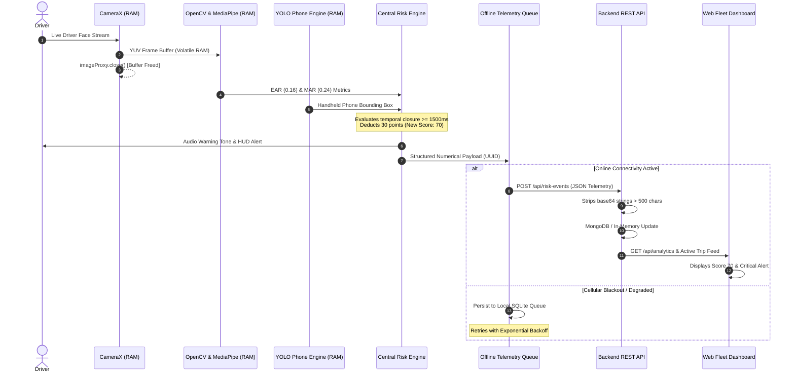

# DriveGuard AI - Privacy & Data-Flow Architecture

DriveGuard AI is built upon a **Privacy-First By Design** architectural foundation. Visual data remains strictly isolated within volatile RAM on the driver's smartphone device.

---

## 🔒 Core Privacy Invariants

1. **Zero Video / Image Egress**: Raw camera video streams, cropped facial frames, and biometric imagery **never** leave the mobile device.
2. **Transient Image Proxy Lifecycle**: CameraX `ImageProxy` YUV buffers are converted to OpenCV/MediaPipe formats in volatile RAM and immediately freed (`imageProxy.close()`) in a `finally` block following inference.
3. **Telemetry Ingestion Scope**: The central server receives exclusively structured numerical metrics (`pointsDeducted`, `finalScore`, `confidence`), categorical event codes (`DROWSINESS`, `PHONE_USE`), and GPS coordinates.
4. **Backend Payload Sanitization**: Ingestion middleware and database services automatically inspect all metadata payloads and discard any base64 payload strings exceeding 500 characters.

---

## 🔄 End-to-End Data Flow Sequence



---

## 📄 Transmitted Telemetry Payload Example

Notice the complete absence of raw visual, biometric, or facial data:

```json
{
  "eventId": "EVT_3a8d0a15-3a8a-4d4e-9bc7-237df159e829",
  "tripId": "TRIP_20261012_101",
  "driverId": "DRV_ALEX_MERCER",
  "type": "DROWSINESS",
  "severity": "CRITICAL",
  "pointsDeducted": 30,
  "latitude": 37.7750,
  "longitude": -122.4195,
  "confidence": 0.94,
  "metadata": {
    "earScore": 0.16,
    "closureDurationMs": 1800
  },
  "timestamp": "2026-10-12T11:15:00.000Z"
}
```

---

## 🛡 Regulatory & Driver Privacy Alignment

| Principle | Implementation Verification |
| :--- | :--- |
| **Data Minimization** | Server stores exclusively what is necessary to calculate safety scores and fleet KPIs. |
| **Storage Limitation** | Transient image buffers in RAM exist for $< 40\text{ ms}$ before immediate deallocation. |
| **Integrity & Confidentiality**| Telemetry uplink transmits over HTTPS with JWT/API authentication. |
| **Driver Dignity** | Drivers are not subjected to invasive remote in-cabin video surveillance. |
