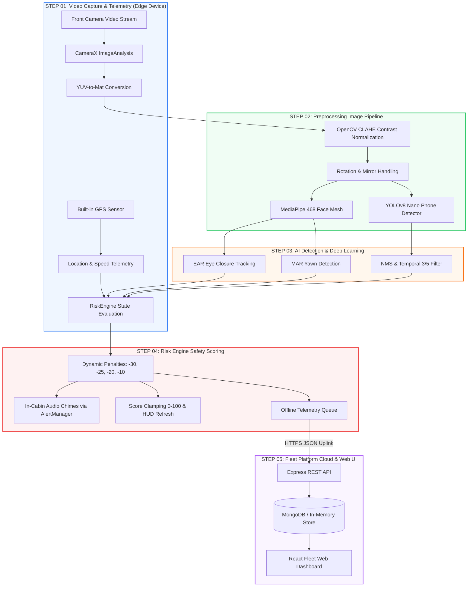

# DriveGuard AI - Proposed Methodology & End-to-End System Pipeline Mapping

This document maps the 5-step **Proposed Methodology Pipeline** directly to the underlying DriveGuard AI codebase components, files, and architectural execution flow.

---

## 🖼 System Methodology Pipeline

---

## 🔗 Step-by-Step Methodology to Codebase Mapping

### STEP 01: Video Capture & Telemetry (Blue Subsystem)
* **Smartphone Camera**: Managed via CameraX front camera in [`CameraManager.kt`](../android-app/app/src/main/java/com/dms/edge/camera/CameraManager.kt).
* **Built-in GPS Sensor**: Managed via [`LocationTracker.kt`](../android-app/app/src/main/java/com/dms/edge/location/LocationTracker.kt) capturing latitude, longitude, speed, and accuracy.
* **30 FPS Live Stream**: CameraX image analysis analyzer [`DriverMonitoringAnalyzer.kt`](../android-app/app/src/main/java/com/dms/edge/ml/DriverMonitoringAnalyzer.kt).
* **In-Cabin Mounting**: High-contrast vehicle HUD UI in [`activity_main.xml`](../android-app/app/src/main/res/layout/activity_main.xml) and [`MainActivity.kt`](../android-app/app/src/main/java/com/dms/edge/MainActivity.kt).

### STEP 02: Preprocessing Image Pipeline (Green Subsystem)
* **OpenCV Framework**: Core preprocessing routines in [`OpenCVPreprocessor.kt`](../android-app/app/src/main/java/com/dms/edge/cv/preprocessing/OpenCVPreprocessor.kt).
* **Face ROI Extraction**: Implemented in [`FrameConverter.kt`](../android-app/app/src/main/java/com/dms/edge/cv/preprocessing/FrameConverter.kt) for cropping the facial region of interest.
* **Frame Normalization**: Cabin illumination contrast enhancement using CLAHE in `OpenCVPreprocessor.kt`.
* **Grayscale & Resizing**: Configured via [`ImagePreprocessConfig.kt`](../android-app/app/src/main/java/com/dms/edge/cv/preprocessing/ImagePreprocessConfig.kt) (640x480 resolution, rotation correction, and mirroring).

### STEP 03: AI Detection Deep Learning (Orange Subsystem)
* **MediaPipe (EAR/MAR)**: 468 3D face mesh landmark extraction in [`MediaPipeFaceLandmarkModule.kt`](../android-app/app/src/main/java/com/dms/edge/cv/mediapipe/MediaPipeFaceLandmarkModule.kt).
* **Eye Blink & Yawn**: 6-point Eye Aspect Ratio in [`EarCalculator.kt`](../android-app/app/src/main/java/com/dms/edge/cv/mediapipe/EarCalculator.kt) ($\ge 1500\text{ ms}$ prolonged closure) and Mouth Aspect Ratio in [`MarCalculator.kt`](../android-app/app/src/main/java/com/dms/edge/cv/mediapipe/MarCalculator.kt) / [`YawnStateMachine.kt`](../android-app/app/src/main/java/com/dms/edge/cv/mediapipe/YawnStateMachine.kt).
* **YOLOv8 (Phone Use)**: Mobile phone object detector in [`YoloMobileEngine.kt`](../android-app/app/src/main/java/com/dms/edge/cv/yolo/YoloMobileEngine.kt), IoU NMS in [`NmsUtility.kt`](../android-app/app/src/main/java/com/dms/edge/cv/yolo/NmsUtility.kt), and 3/5 temporal filter in [`TemporalDetectionFilter.kt`](../android-app/app/src/main/java/com/dms/edge/cv/yolo/TemporalDetectionFilter.kt).
* **Head Pose Estimate**: Head rotation yaw and pitch orientation calculation in [`FrameAnalysisResult.kt`](../android-app/app/src/main/java/com/dms/edge/cv/FrameAnalysisResult.kt).

### STEP 04: Risk Engine Safety Scoring (Red Subsystem)
* **Base Score: 100 Pts**: Trip score initialized to 100 in [`RiskEngine.kt`](../android-app/app/src/main/java/com/dms/edge/engine/RiskEngine.kt).
* **Dynamic Deductions**: Baseline penalty rules (`-30` Drowsiness, `-25` Phone Use, `-20` Distraction, `-10` Yawning) in [`RiskEngineConfig.kt`](../android-app/app/src/main/java/com/dms/edge/engine/RiskEngineConfig.kt).
* **Live In-Cabin Alert**: Visual warning banner and score HUD updates in [`MainActivity.kt`](../android-app/app/src/main/java/com/dms/edge/MainActivity.kt).
* **Audio/Buzzer Trigger**: Warning audio chime generation via `ToneGenerator` in [`AlertManager.kt`](../android-app/app/src/main/java/com/dms/edge/alert/AlertManager.kt).

### STEP 05: Fleet Platform Cloud & Web UI (Purple Subsystem)
* **Node.js & Express API**: Express REST controllers and routes in [`backend/src`](../backend/src) (`/api/drivers`, `/api/trips`, `/api/risk-events`, `/api/score-snapshots`, `/api/analytics`).
* **MongoDB Cloud DB**: Mongoose data models ([`Driver.js`](../backend/src/models/Driver.js), [`Trip.js`](../backend/src/models/Trip.js), [`RiskEvent.js`](../backend/src/models/RiskEvent.js), [`ScoreSnapshot.js`](../backend/src/models/ScoreSnapshot.js)) with hybrid dual-mode persistence.
* **React Web Dashboard**: Responsive React + Tailwind UI in [`web-dashboard/src`](../web-dashboard/src) ([`Dashboard.jsx`](../web-dashboard/src/pages/Dashboard.jsx), [`Analytics.jsx`](../web-dashboard/src/pages/Analytics.jsx), [`ActiveTrips.jsx`](../web-dashboard/src/pages/ActiveTrips.jsx), [`TripDetail.jsx`](../web-dashboard/src/pages/TripDetail.jsx), [`Drivers.jsx`](../web-dashboard/src/pages/Drivers.jsx), [`Alerts.jsx`](../web-dashboard/src/pages/Alerts.jsx)).
* **Live Vehicle Tracking**: Interactive GPS coordinate route trail mapping in `TripDetail.jsx` and `Analytics.jsx`.
